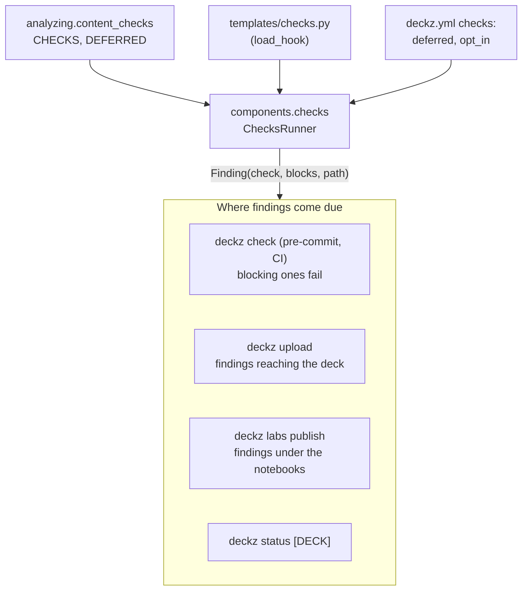

# Analyses and checks

`deckz.analyzing` holds the repository-wide analyses that read a repository, and
sometimes its built outputs, without building anything. Most return data that a
command, `status` or a check renders. A few edit files on request (renaming and merging
flavors, marking a translation synced).

| | |
|---|---|
| **Responsibility** | Read-only analyses of a managed repository, its git history and its built outputs; deckz's own content checks |
| **Owns** | The built-in checks (`content_checks.CHECKS`) and which ones are deferred (`DEFERRED`) |
| **Depends on** | `checking`, `course_notes`, `labs`, `extras` (optional imports), `commits`, the factories (parsers), `components.frame_markers`/`marker_records` (what builds recorded) |
| **Never** | Compiles. Reading a built PDF uses what its compilation recorded (`<main>.markers.json`), or a Typst query when there is no record |
| **Fails with** | `DeckzError` subclasses, or findings (lists of messages) for checks |

## The modules

| Module | Backs | What it does |
|---|---|---|
| [`content_checks`][deckz.analyzing.content_checks] | `deckz check` | Generic content checks, each a `(settings, paths) -> list[str]` in `CHECKS`: `lab-ids`, `lab-pairs`, `lab-outputs`, `lab-secrets`, `lab-format`, `asset-credits`, `raw-latex`, `jinja-syntax`, `deck-definitions`, `lab-urls`, `course-notes-files`, `course-notes-pairs` |
| [`affected`][deckz.analyzing.affected] | `deckz show affected`, `status`, `upload` | Which decks a change of some files reaches (in French: an `en/` file counts as its French sibling), and their findings |
| [`i18n_stale`][deckz.analyzing.i18n_stale] | `deckz i18n stale`, `mark-synced`, the commit-msg hook | fr/en pairs, and their staleness from the history's `Lang-sync` trailers |
| [`i18n_coverage`][deckz.analyzing.i18n_coverage] | `deckz i18n missing-en`, `status` | French content, titles and variables with no English counterpart |
| [`variables_usage`][deckz.analyzing.variables_usage] | `deckz check variables` | Every shared section's named flavors (through `Parser.from_section`) with the repository's variables, and every deck with its own: `variables.xxx` that nothing sets (`undefined`), fragments the repository's Jinja can't parse (`unparsable`), flavors or decks that don't parse (`structural`, caught per context) |
| [`frames`][deckz.analyzing.frames] | `deckz show frames`, studioz | Which content file and line each page of a built PDF shows |
| [`overflow`][deckz.analyzing.overflow] | `deckz check overflow`, `status`, studioz | Shrunk frames, wrapped tables and lines, with their sources |
| [`parity`][deckz.analyzing.parity] | `deckz check parity` | Compare a deck's PDF and HTML versions, slide by slide (`deckz[parity]`) |
| [`sections_search`][deckz.analyzing.sections_search] | `deckz search-sections`, `section-files`, `section-flavors` | Find shared sections by keyword, list their flavors and files |
| [`sections_analyzer`][deckz.analyzing.sections_analyzer] | `deckz deps` | Which sections, flavors and files the decks use |
| [`flavor_renamer`][deckz.analyzing.flavor_renamer], [`flavors_merger`][deckz.analyzing.flavors_merger], [`flavor_files`][deckz.analyzing.flavor_files] | `deckz flavor rename`, `deduplicate` | Edit section definitions and every deck referring to them |

## Content checks

`deckz check` runs the built-in checks together with the managed repository's own. A
`templates/checks.py` module defines `checks(settings)`, which returns a mapping of
names to callables (see [the repository's plugins](plugins.md)).
[`ChecksRunner`][deckz.components.checks.ChecksRunner], from
`GlobalSettingsFactory.checks_runner()`, merges the two. A plugin check with a built-in's
name is a `HookError`.

- Most built-ins are generic lab and asset checks. `jinja-syntax` parses each content
  file with the repository's own Jinja environment and checks its filter and test
  names; `deck-definitions` parses every deck in French, in a process pool.
- A check **blocks** or is **deferred** (`ChecksSettings.blocking`: `deckz.yml`'s
  `checks.deferred`, else `content_checks.DEFERRED`, every built-in but `lab-secrets`,
  `jinja-syntax` and `deck-definitions`; a plugin check blocks unless listed). `deckz
  check` fails on a blocking check's findings, or on any finding of a check named on its
  command line; `--plain` and `--json` say which block, and `deckz status` and studioz
  mark them (`blocks_commit`). A blocking
  check's findings fail `deckz check`, and so the commit. A deferred check's harm comes
  later, so its findings fail the gate where that harm happens: `deckz upload` fails on
  the findings reaching the deck, and `deckz labs publish` on those under the notebooks
  directory. Both commands accept `--skip-checks`.
- `ChecksRunner.findings()` gives each problem as a `Finding`: its check, whether it
  blocks, and `path`, the file its text starts with. The gates filter findings by that
  path: `deckz upload` keeps those of the files that reach the deck
  (`affected.deck_findings`, `affected.reaches`), `deckz labs publish` those under the
  notebooks directory, and `deckz status DECK` (`status.deck_status`) the deck's.
- A check in `checks.opt_in` (a slow, networked, or not yet passing check) runs only
  when named on the command line: `deckz check`, the pre-commit hook and the post-edit
  agent hook skip it.
- `--staged` runs the checks on the staged tree exported to `.check/staged/`
  (`checking.export_staged`), so another session's unfinished edits neither block a
  commit nor hide a problem.

A new rule about content is a check here (generic) or in the repository's
`templates/checks.py` (house rule), not a step in a skill or a reviewer's memory.

## fr/en pairing

`i18n_stale` decides what a fr/en pair is (`content_pairs`, `notebook_pairs`,
`lang_pairs`, and `lang_sync_kind` for a commit's choice): content files (`x.md` and
`en/x.md`), lab notebooks, and course notes chapters (through `course_notes.course_notes_pairs`). Its
history walk reads the trailers that `commits` writes. The commit-msg hook, `deckz i18n
stale`, the Stop agent hook, `status` and studioz's commit dialog all use the same
pairing and verdicts.

- The commit-msg hook (`deckz hooks check-commit-msg`) marks a commit whose staged diff
  touches one side of a pair (`staged_one_sided_pairs`) and whose message makes no
  choice `Lang-sync: pending` (`mark_pending`, through `git interpret-trailers`).
  Refusing it would protect nothing: `stale_files` reads a commit with no trailer as
  pending anyway. It refuses (`CommitRefusedError`), and `deckz hooks check-commits`
  (`one_sided_commits`, in CI) fails, only on a `Lang-sync` line it can't read
  (`unread_lang_sync`): the author's choice would be lost.
- A change found later to need no port leaves `deckz i18n stale` through `deckz i18n
  mark-synced` (`mark_synced`): an empty commit (`--only`, so nothing staged goes in)
  naming each file in a `Lang-synced` trailer, which the history walk takes as the
  pair's sync point.
