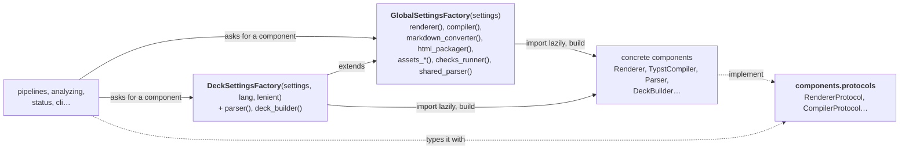

# Components

`deckz.components` holds the pieces a build is made of, behind protocols, with factories
as their only construction points.

| | |
|---|---|
| **Responsibility** | Parse decks, render templates, convert Markdown, compile, package HTML, build and search assets, run checks |
| **Owns** | A deck's build directory (`.build/`): rendered fragments, `.render-fingerprint`, `.links`, `<main>.markers.json`; the compilation slots; the Typst worker processes |
| **Depends on** | `configuring`, `models`, `utils`, `stamps`, `drive_links`, `exceptions` |
| **Never** | Decides what to build (that is `pipelines`), prints, or exits |
| **Entry points** | [`GlobalSettingsFactory`][deckz.components.factory.GlobalSettingsFactory], [`DeckSettingsFactory`][deckz.components.factory] |
| **Fails with** | `DeckzError` subclasses: `DeckParsingError`, `RenderError`, `HookError`, `InvalidConfigurationError`… A compilation failure is a `CompileResult` that isn't ok, which `pipelines` turns into a `CompilationError` |

## Protocols and factories

[`protocols`][deckz.components.protocols] defines a `Protocol` for every major piece.
The factories build the implementations, wired with their settings and paths. They
import each implementation inside the method that returns it, so that
`deckz --help` doesn't import Typst or Jinja.

Code outside `components` gets a component from a factory and types it with its
protocol. The `factories` contract enforces this for the components that have a protocol
of their own. Value types and helpers are imported directly: `PlannedCompile`,
`Finding`, `PartDependenciesNodeVisitor`, `compiler.keep_warm`/`stop`, the frame marker
helpers. A new implementation (another compiler, another converter) is plugged in at a
factory, and nothing else changes.

## The components

| Component | Protocol | Responsibility |
|---|---|---|
| [`Parser`][deckz.components.parser.Parser] | `ParserProtocol` | Turn `deck.yml` and section `.yml` files into the `Deck` model, resolving each path to shared or local content. Parses in one language; `lenient` lets a title or translation map missing it fall back |
| [`Renderer`][deckz.components.renderer.Renderer] | `RendererProtocol` | Render Jinja templates with the repository's own environment (`templates/jinja2/env.py`), injecting `assets_metadata_retriever` |
| [`PandocConverter`][deckz.components.markdown_converter] | `MarkdownConverterProtocol` | Convert a rendered fragment with `pandoc_command` (or `html_pandoc_command`) and its filters; its `fingerprint` invalidates every fragment when they change |
| [`FrameMarkingConverter`][deckz.components.frame_markers.FrameMarkingConverter] | `MarkdownConverterProtocol` | Wraps the Typst converter: an invisible `<deckz-frame>` marker after each `# Title` |
| [`TypstCompiler`][deckz.components.compiler.TypstCompiler] | `CompilerProtocol` | Compile a main `.typ` to PDF in a child process, query and record its markers |
| [`HtmlPackager`][deckz.components.html_packager] | `CompilerProtocol` | Package an HTML page and every local file it references into `html/<name>/` |
| [`DeckBuilder`][deckz.components.deck_builder.DeckBuilder] | `DeckBuilderProtocol` | One deck's build: copy, render and convert fragments, render main templates, compile each output, publish them; `plan()` |
| [`AssetsBuilder`][deckz.components.assets_builder.AssetsBuilder] | `AssetsBuilderProtocol` | Run the repository's assets builders under `assets_lock` |
| [`TypstFiguresAssetsBuilder`][deckz.components.typst_figures_builder.TypstFiguresAssetsBuilder] | `AssetsBuilderProtocol` | A built-in assets builder a repository may return: Typst figures to SVG, per language, stamped |
| [`AssetsMetadataRetriever`][deckz.components.assets_metadata_retriever], [`AssetsSearcher`][deckz.components.assets_searcher], [`AssetsAnalyzer`][deckz.components.assets_analyzer] | their own | Assets' metadata (credits, licenses), which decks use an asset, unlicensed images |
| [`ChecksRunner`][deckz.components.checks.ChecksRunner] | `ChecksRunnerProtocol` | Merge built-in and plugin checks, run them, give `Finding`s |
| [`load_hook`][deckz.components.hooks.load_hook] | | Load a plugin module from the managed repository, checking its `DECKZ_HOOKS_VERSION` |
| [`MachineSlots`][deckz.components.machine_slots.MachineSlots] | | A machine-wide limit on concurrent compilations, shared by every deckz process |
| [`marker_records`][deckz.components.marker_records] | | Read and write `<main>.markers.json` |
| `NullProgress`, `PrefixedProgress` | `ProgressReporterProtocol` | Progress reporters that draw nothing, or prefix another's labels |

## The deck builder's outputs

Each output has a `Format`. The factory hands the deck builder one `OutputFormat` per
format: a main template, a fragment suffix, a Markdown converter, a "compiler", and an
output directory.

| `CompileType` | `Format` | Main template | Converter | "Compiler" | Output |
|---|---|---|---|---|---|
| `Handout`, `Presentation`, `PrintHandout` | Typst | `main.typ` | `pandoc_command` + frame markers | `TypstCompiler` | `pdf/` |
| `Html` | Html | `main.html` | `html_pandoc_command` | `HtmlPackager` | `html/<name>/` |
| `CourseNotes` | its own | `course-notes.typ` | `pandoc_command` + frame markers | `TypstCompiler` | `pdf/course-notes/` |

The main template is rendered after its fragments. It gets a `fragment(section)`
callable returning a converted fragment's text, which HTML needs because it has no
`#include`. deckz knows nothing of reveal.js or the theme: the repository supplies
those in its templates and Lua filters.

## Process boundaries

- **Typst runs in a child process**, never in deckz's own (see the comment at the top
  of `components/compiler.py`): Typst's cache is global to a process and only grows.
  `keep_warm()` keeps one worker per main file across `--watch` rebuilds. `stop()` kills
  every worker, and the CLI calls it on Ctrl-C. Workers start with SIGINT blocked.
- **Memory**: `typst_memory_max` stops a worker whose resident memory exceeds it.
  `typst_machine_compilations` makes each compilation hold a slot shared by every deckz
  process on the machine.
- **pandoc** runs as a subprocess per fragment. Fragments render in threads
  (`ThreadPoolExecutor`): rendering is cheap next to the subprocesses, and threads keep
  the warm Typst workers reachable.
