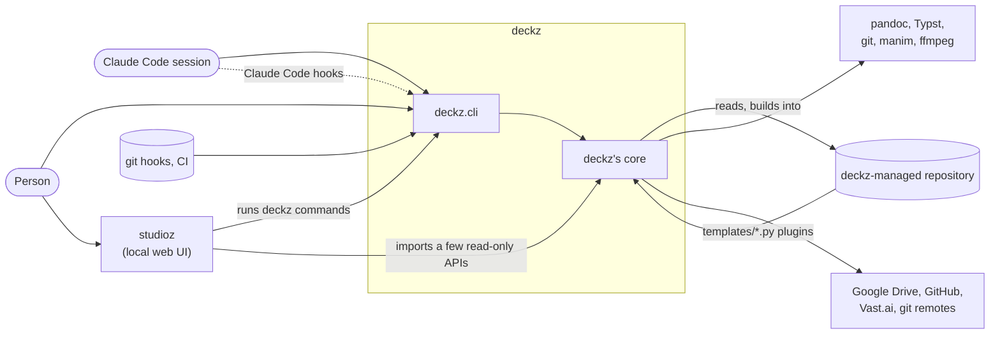
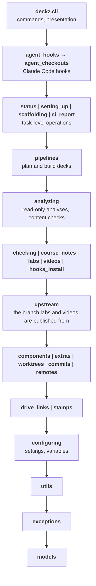

# Architecture

These pages are for the people working on deckz's own code. They describe the parts of
deckz, what each one is responsible for, what it may depend on, and what crosses the
boundaries between them. The [code reference][deckz] documents each function and class.
The [guide](../guide/index.md) is for the people running a deckz-managed repository.

| Page | What it covers |
|---|---|
| This page | The context, the layers, and the rules that hold them |
| [Command line](cli.md) | `deckz.cli`: wiring, the error boundary, output |
| [Tasks](tasks.md) | `status`, `setting_up`, `scaffolding`, `ci_report`, the agent hooks, `hooks_install` |
| [Build pipeline](pipelines.md) | `pipelines`, `checking`, `course_notes`: planning and building decks |
| [Analyses and checks](analyzing.md) | `analyzing`: read-only analyses, content checks |
| [Components](components.md) | `components`: protocols, factories, and their implementations |
| [Domain libraries](libraries.md) | `labs`, `videos`, `upstream`, `extras`, `worktrees`, `commits`, `remotes` |
| [Foundations](foundations.md) | `configuring`, `models`, `exceptions`, `utils`, `stamps`, `drive_links` |
| [The repository's plugins](plugins.md) | What a deckz-managed repository plugs in, and what it may import |
| [studioz](studioz.md) | How studioz uses deckz |
| [Files and concurrency](state.md) | What deckz writes, where, and who else may be writing it |

## Context

deckz is a command-line tool that operates on a separate git repository: a
*deckz-managed repository*, with its `deckz.yml`, `content/`, `templates/`, decks and
labs. Keep two things apart. One is deckz's own code (this repository). The other is
the repository deckz runs on. That repository also supplies Python code that deckz
loads and runs (see [the repository's plugins](plugins.md)).

Everyone uses the same command line: a person, an agent, the git hooks, CI and studioz
all run the same `deckz` commands. A rule that only an agent, or only studioz, follows
is a missing command (see "Operability guidelines" in `CLAUDE.md`).

## Layers

deckz's core is layered. A module may import from its own layer or from a layer below,
never from one above. Modules separated by `|` in the same layer are also independent
of each other. The `layers` contract in `pyproject.toml` (`[tool.importlinter]`)
encodes this diagram, and `uv run doit check` fails when an import breaks it. The
contract is exhaustive: a new module of `deckz` fails it until it has a layer.

Imports into deckz's core are mostly lazy (inside the function that needs them), so
that `deckz --help` and the hooks start quickly. A lazy import is still a dependency,
and the contracts count it.

## Rules

The rules are enforced where possible. `uv run lint-imports` checks the contracts
alone, and each broken contract prints how to fix it.

| Rule | Enforced by |
|---|---|
| A module never imports from a layer above it | `layers` contract |
| Only the command lines (`deckz.cli`, `studioz.cli`) import `rich` or `cyclopts`: the core reports progress through a [`ProgressReporterProtocol`][deckz.components.protocols.ProgressReporterProtocol] and failures by raising a [`DeckzError`][deckz.exceptions] | `terminal` contract |
| Code outside `deckz.components` gets a component from a factory and types it with its protocol, never by importing its class | `factories` contract (for the components with a protocol of their own) |
| deckz never imports studioz | `studioz` contract |
| studioz runs deckz's commands, never imports `deckz.cli` | `studioz-cli` contract |
| A command function only parses its arguments, builds settings and calls the core | Review |
| stdout carries results only (`--json` included); logs and progress go to stderr | Review, tests of `--json` output |
| Every failure names its fix | Review |
| A plugin from the managed repository is loaded only through [`load_hook`][deckz.components.hooks.load_hook] | Review |

## Known exceptions

The contracts list each known exception in their `ignore_imports`, with a comment saying
why. A listed exception that no longer exists fails the contract, so fixing one also
means removing its line. They are:

| Import | Why it's there | The fix |
|---|---|---|
| `analyzing.affected` → `status` | `deckz show affected --since` reuses `status`'s git queries (`base_revision`, `changed_paths`) | Move those queries to a git module below both |
| `components.checks` and `configuring.settings` → `analyzing.content_checks` | The built-in checks and their `DEFERRED` set are defined next to the checks | Move the registry (names, deferred set) down, and have the checks register themselves into it |
| `utils` → `components.factory`, `configuring` | `parse_deck`, `all_decks` and `all_deck_settings` parse decks, a job above `components` | Move them to their own module above `components` |
| `extras.uploading` → `rich` | `Uploader` draws its own transfer progress bars | Take a `ProgressReporterProtocol`, as the builds do |

## Keeping these pages up to date

These pages are part of a change, not a separate task. A change updates them when it:

- adds, moves, splits or removes a module or package of `deckz` (its layer, in the
  contract and the diagram above, and its page);
- adds a dependency between layers, or a known exception (the contract, and the table
  above);
- changes what a component owns on disk, a lock, or a process boundary
  ([Files and concurrency](state.md));
- changes what the managed repository plugs in or imports ([plugins](plugins.md)), or
  what studioz relies on ([studioz](studioz.md)).

A page describes responsibilities and boundaries, and links to the code reference for
the details. It doesn't restate signatures, which the code reference renders from the
docstrings.
