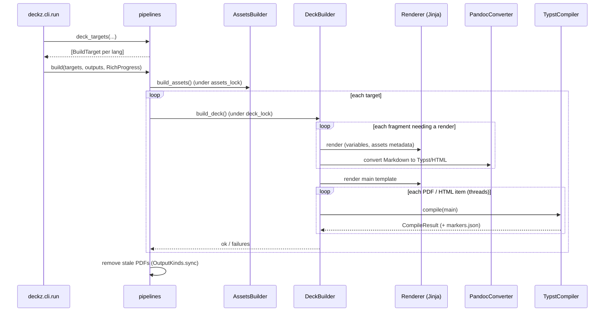

# Build pipeline

`pipelines` turns "build this" into compiled PDFs and HTML. It is the layer that knows
what a build is: its targets, their order, the locks, and what to remove afterwards.

| | |
|---|---|
| **Responsibility** | Plan and run builds: targets, assets, compilation, stale outputs, `--watch` |
| **Owns** | `BuildTarget`, `OutputKinds`; the per-deck build lock (`deck_lock`); removing stale PDFs |
| **Depends on** | The factories (deck builder, assets builder, parsers), `checking`, `course_notes`, `configuring.variables`, `analyzing.affected` (for `--since`) |
| **Never** | Renders, converts or compiles anything itself (the [components](components.md) do); prints (it reports through a `ProgressReporterProtocol`) |
| **Entry points** | [`build`][deckz.pipelines.build], [`plan`][deckz.pipelines.plan], the `*_targets` functions, [`watch`][deckz.pipelines] |
| **Fails with** | [`CompilationError`][deckz.exceptions] naming the target, [`BuildsFailedError`][deckz.exceptions.BuildsFailedError] with `keep_going`, [`RenderError`][deckz.exceptions.RenderError] |

## Planning, then building

Planning is separate from building. Every `deckz run` command first computes its
[`BuildTarget`][deckz.pipelines.BuildTarget]s: one parsed `Deck` per language, with the
settings to build it with, a label naming it in a failure, and optionally `basedirs`
(where its files live), `parts`, and `course_notes`.

| Command | Targets from |
|---|---|
| `deckz run [deck]` | `deck_targets` |
| `deckz run file` | `file_targets` (a scratch deck of one file, see `checking.preview_settings`) |
| `deckz run section` | `section_targets` |
| `deckz run decks` | `decks_targets` (every deck of the repository) |
| `deckz run shared` / `all` | `shared_targets` / `all_targets` (synthetic decks built by `checking`) |
| `deckz run course-notes` | `course_notes_targets` (each deck's chapters, see `course_notes`) |

Then either [`build`][deckz.pipelines.build] builds them, or, with `--dry-run`,
[`plan`][deckz.pipelines.plan] returns each target's deck builder's `plan()` without
building anything (assets included): each `PlannedCompile` and the fragments it would
render again. Both use the same freshness test (`needs_render`).

## A build

1. **Assets** are built once per build, for every target. The repository's own
   assets builders (`templates/assets_builders.py`) run under the repository-wide
   `assets_lock`.
2. **Each target** compiles under `deck_lock`, an `flock` on `<build_dir>/.lock`, so
   that two builds of one deck (a `--watch` and a full build) wait for each other.
3. **The deck builder** copies every fragment into the build directory first. It
   renders those whose source changed, or all of them when the render fingerprint
   changed (the converter's command and filters, and the deck's variables). It renders
   the main template last, and then compiles each output.
4. **Stale PDFs** are removed only after every target compiled (`--sync`, on by
   default): the PDFs of the targets' output directories, in the languages built, that
   no full build of the deck would write. A narrower build (`--parts`, one language)
   never removes what it skipped.

A failure in a target raises at once. With `keep_going` (`deckz run decks --report`),
every target is built and the failures are raised together.

## `checking`

[`checking`][deckz.checking] builds the synthetic decks and scratch settings that have
no deck directory of their own. It is a layer below `pipelines`, so `analyzing` can use
it too.

- `build_shared_deck` and `build_all_deck` build in memory a deck holding every shared
  section, each expanded to all its files (`Parser.all_files_section`). `run all` also
  adds a copy of a section for each deck that overrides one of its files. Nothing is
  written as YAML.
- `preview_settings` is a copy of a deck's settings pointing at a scratch output
  directory, for `run file` and `run section`. Settings are never mutated.
- `run_scratch_dir` (`<git_dir>/.run/<name>/`) and `check_scratch_dir`
  (`<git_dir>/.check/<name>/`) are the scratch trees, and `export_staged` exports the
  git index to `.check/staged/` for `deckz check --staged`.

## `course_notes`

[`course_notes`][deckz.course_notes] knows a deck's course notes: one chapter per
content file, under `course-notes/`, mirroring `content/`. `chapters_deck` gives the
deck's tree with each file replaced by its chapter. `pipelines.course_notes_targets`
then builds that tree through the deck builder's `CourseNotes` output, which has its own
main template and output directory. `course_notes_pairs` adds the chapters to the fr/en
pairs that `analyzing.i18n_stale` follows.

## `watch`

[`watch`][deckz.pipelines] is generic: it reruns a function whenever a file under
the watched directories changes. `run deck`, `run file`, `run section` and `run assets`
call it with their own one-shot pipeline function, which parses again on each change.
It holds `compiler.keep_warm()` for its whole run, so each PDF keeps a warm Typst worker
and rebuilds are incremental. studioz reads the progress of a `deckz run --watch` from
its log messages, so these messages are a contract with studioz (see
[studioz](studioz.md)).
