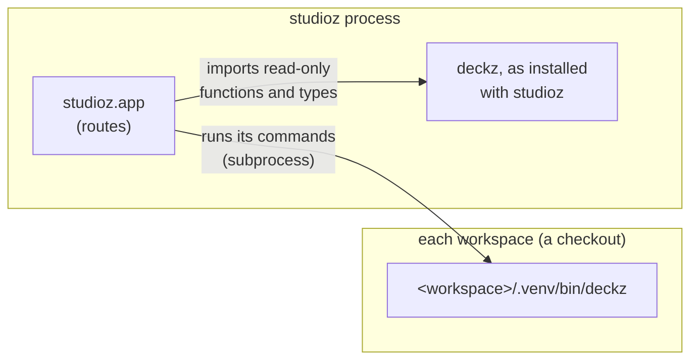

# studioz

studioz is the second package of this repository (`studioz/`): a local web UI for
working on a managed repository. Its own architecture (routes, workspaces, watches, the
agent, jobs) is in `studioz/CLAUDE.md`. This page covers only its boundary with deckz.

## Two ways in

studioz uses deckz in two ways, and the difference matters.

1. **Commands, in the workspace's own deckz.** Whatever changes a workspace or depends
   on its repository's rules runs as a subprocess: `deckz status --json`, `deckz show
   affected --json`, `deckz run --watch`, `deckz check --staged --plain`, `deckz upload`,
   `deckz labs …`, `deckz videos …`, `deckz i18n …`. It runs `<workspace>/.venv/bin/deckz`,
   the deckz that workspace's repository pins, which may not be studioz's own version.
2. **Imports, of studioz's own deckz.** studioz imports only read-only functions and
   types that need no build: `deckz.analyzing.frames`, `deckz.analyzing.overflow`,
   `deckz.analyzing.i18n_stale.one_sided`, `deckz.worktrees`, `deckz.setting_up`,
   `deckz.configuring.settings`, `deckz.models`, `deckz.exceptions`, and a couple of
   `deckz.utils` helpers.

## The rules

- **deckz never imports studioz** (`studioz` contract). deckz's core knows nothing of
  the web stack.
- **studioz never imports `deckz.cli`** (`studioz-cli` contract). It runs commands, so a
  person and studioz go through the same code.
- **A rule studioz needs goes into deckz**, as a function or a command, never into
  studioz alone. studioz shows what deckz decides (a check's verdict, what blocks a
  commit, what is stale).
- **Never compile in studioz's process.** Pages are mapped to sources from what the
  build recorded (`analyzing.frames`), and builds run in `deckz run --watch`.

## What deckz must keep stable for studioz

studioz reads these from the workspace's deckz, so changing them is a change of studioz
too:

- the `--json` output of `deckz status`, `deckz show affected`, `deckz upload
  --dry-run`, `deckz i18n stale`, `deckz labs list`, `deckz videos list`;
- the `--plain` output of `deckz check --staged` and `deckz labs gpu status`;
- the log messages of [`pipelines.watch`][deckz.pipelines], from which studioz
  follows a `deckz run --watch`;
- the files a build records: `<main>.markers.json`, and the build directory's layout.

The repository is one uv workspace (`[tool.uv.workspace]`, a deliberate divergence
from the Copier template): one `uv.lock`, studioz depends on deckz `{ workspace = true }`,
pinned to the same version, the `dev` group installs it for the tests, and both are
released together. `plans/studioz.md` is studioz's plan, with what is done.
